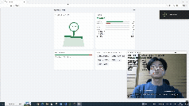
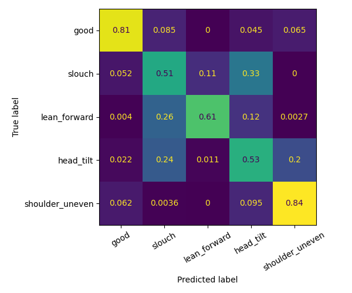

# Posture Twin：即時坐姿矯正的 Digital Twin 與 MLOps 系統

用一般視訊鏡頭即時判斷坐姿，在虛擬人偶上呈現你的身體狀態，並建立一套完整的 MLOps 閉環：**資料版本控管 → 實驗追蹤 → 服務部署 → 監控與 drift 偵測 → 使用者回饋 → 自動重新訓練 → 新模型上線**。

<!-- 放一張 GIF 或截圖：左邊是鏡頭畫面，右邊是 /ui 的人偶。面試官 10 秒內要能看懂這個專案在做什麼 -->

## 這個專案展示了什麼

| 面向 | 做法 |
|---|---|
| Digital twin | 感測資料即時更新一個虛擬身體狀態：目前姿勢、累積不良時間、近 10 分鐘分佈，並用網頁人偶呈現 |
| 實驗追蹤與模型管理 | MLflow 記錄參數、指標、混淆矩陣；Model Registry 管理上線版本 |
| 服務化與部署 | FastAPI 推論服務，Docker + docker-compose 一鍵啟動 6 個服務 |
| CI/CD | GitHub Actions：單元測試、設定檔驗證、建置映像檔、容器 smoke test、推送到 GHCR |
| 監控 | Prometheus 收集指標、Grafana 儀表板、5 條以上警報規則 |
| 資料 drift 偵測 | PSI + KS 檢定，比較即時資料與訓練資料的分佈 |
| 持續訓練 | 使用者按「其實是…」產生新標註 → 累積足夠後自動重新訓練 → 通過把關才上線 |

**為什麼 Edge 不放進 Docker**：Docker 在 WSL2 裡抓不到 Windows 的鏡頭，所以鏡頭程式在 Windows 原生執行，只把數值特徵傳給服務。這也讓影像永遠不離開使用者的電腦，是刻意的隱私設計。

## 關鍵設計決策

1. **正面鏡頭 + 間接特徵**：正面看不到側面輪廓，MediaPipe 的深度（z 軸）誤差大，頸部前傾角不可靠。改用肩寬、臉寬的變化推估前傾，所有長度都以肩寬正規化，不受離鏡頭遠近影響。
2. **個人化校準**：每個人的坐姿與鏡頭位置不同，系統記錄「你的標準坐姿」，之後所有判斷都是相對這個基準的偏差。
3. **依 session 分組做交叉驗證**：同一次錄製的連續幀非常相似，隨機切分會讓分數虛高。整個 session 留作驗證，測的是對新環境的泛化能力。
4. **規則式 baseline 常駐**：ML 模型必須勝過規則式才算有價值；同時它也是模型載入失敗時的備援，服務不會因此中斷。
5. **drift 只比較「被判為 good」的樣本**：訓練資料是刻意擺出的各種姿勢，即時資料大多是 good，直接比整個資料集會永遠報 drift。good 對 good 才能抓到鏡頭角度、光線、校準過期這類環境變化。
6. **drift 只通知、不直接觸發訓練**：分佈變了但沒有新標註，重新訓練也學不到新東西。真正的觸發條件是累積了足夠的新標註。
7. **新模型要通過把關才上線**：F1 不低於下限、勝過規則式、不比現行模型差超過容忍值，避免自動化造成品質倒退。

## 成果

| 指標 | 規則式 baseline | LogisticRegression | RandomForest |
|---|---|---|---|
| macro F1（依 session 分組交叉驗證） | `0.55` | `0.50` | `0.66` |

- 資料量：`4277` 筆、`3` 個 session、`5` 種姿勢
- 推論延遲 p95：`49` ms（Grafana 面板）
- 混淆矩陣與 MLflow 截圖：

## 測試與 CI

- 54 個單元測試涵蓋：特徵計算、One Euro Filter、twin 狀態、API 端點、drift 計算、重新訓練觸發與把關、通知
- 每次 push 自動執行：測試 → 設定檔驗證（compose、Prometheus、Grafana）→ 建置映像檔 → 啟動容器做 smoke test → 推送到 GHCR

## 已知限制與下一步

- 正面鏡頭沒有可靠的深度，人偶是 2D；3D 骨架需要側面或第二個視角
- 模型上線把關只做「不退步」檢查，新舊模型用的資料不同；更嚴謹的做法是固定 hold-out 測試集
- Digital twin 狀態存在記憶體，重啟會歸零，目前設計給單人使用
- 警報尚未接 Alertmanager；回饋標註沒有檢視與刪除功能
- 下一步：時間窗口特徵 / LSTM、hold-out 測試集評估、Alertmanager、標註管理介面

## 技術棧

Python · MediaPipe · OpenCV · scikit-learn · FastAPI · MLflow · DVC · Docker Compose · GitHub Actions · Prometheus · Grafana · Evidently · pytest
